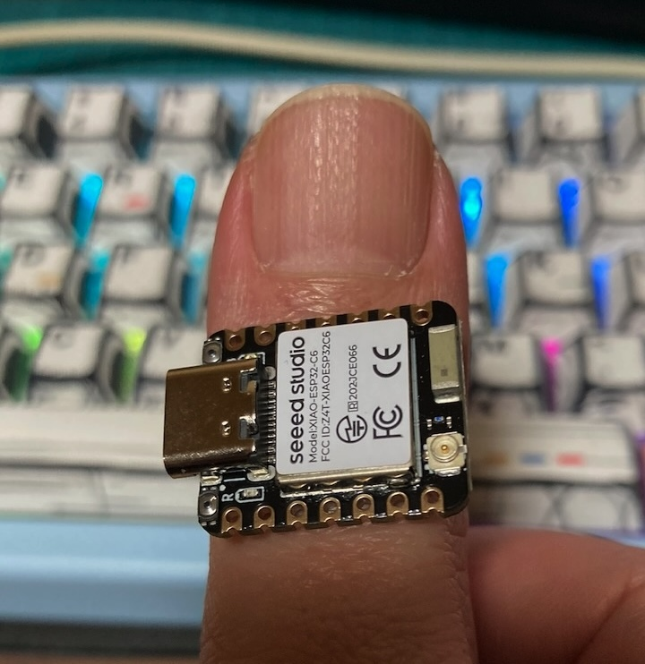
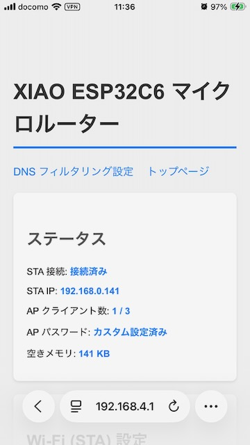
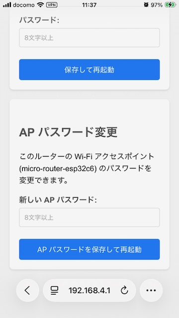
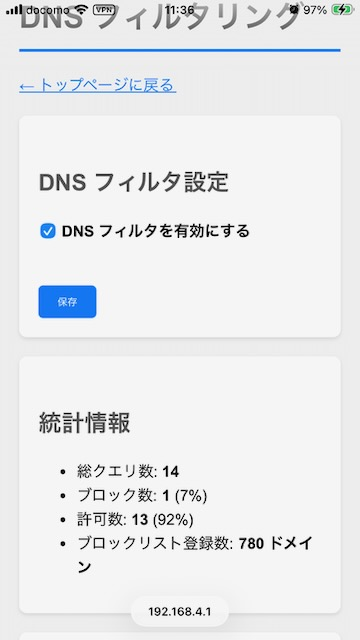
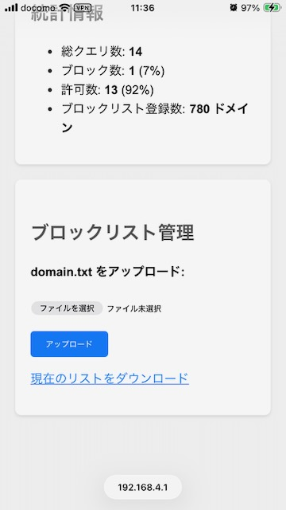

# XIAO ESP32-C6 マイクロ Wi-Fi ルータ

**Seeed Studio XIAO ESP32C6** (RISC-V) を使用した、極小・セキュア・ポータブルな Wi-Fi ルータの実装です。**NAT ルーティング**、**デュアルモード Wi-Fi**、そしてハードウェアレベルでの **DNS 広告ブロック**機能を備えています。

## 主な機能

- **🚀 NAT ルーティング**: 上流ネットワークに接続しつつ、プライベートな Wi-Fi ネットワーク (`192.168.4.x`) を提供します。
- **🛡️ DNS フィルタリング (広告ブロック)**: ルータレベルで広告やトラッカを遮断します。カスタムブロックリスト（最大約 5,000 ドメイン）に対応。
- **📶 デュアルモード**: ステーション (STA) モードとアクセスポイント (AP) モードで同時に動作します。
- **⚙️ Web インターフェース**: `http://micro-router.local` (または `192.168.4.1`) から簡単に設定可能。
- **💾 設定の永続化**: Wi-Fi 認証情報は端末固有鍵で暗号化して不揮発性メモリに保存します。
- **🔄 自動再接続**: 上流ネットワークが切断された場合、自動的に再接続を試みます。

## セキュリティに関する補足

- STA の SSID、STA パスワード、AP パスワードは、NVS 保存時に端末固有鍵で暗号化されます。
- 暗号化鍵はデバイスごとに異なるため、別の基板へ保存データをそのまま移しても復号できません。
- 旧バージョンで平文保存されていた設定は、起動時に自動的に暗号化形式へ移行されます。
- この変更はフラッシュ内容の直接読み出しに対する防御を強化しますが、Web UI の認証や通信路保護の代替ではありません。

## ハードウェア要件

- **Seeed Studio XIAO ESP32C6** (RISC-V アーキテクチャ)
  - _注意: SDK の違いにより、XIAO ESP32-C3/S3 とは互換性がありません。_
- USB-C 電源
- [ロッドアンテナ](https://www.switch-science.com/products/8637?srsltid=AfmBOorYfYhZlwbtTnjM_BVI_2CNzRxPAIbcTrlz1YavxpxQNJl2zq6w)
  - _補足: XIAO ESP32C6 単体でも近場なら十分に電波は届きますが、ロッドアンテナがあると、-35dBm 〜 -40dBm くらいで安心できます。_

## 始め方

### 1. インストール

1. Arduino IDE で **ESP32 Board Package v3.0.0+** をセットアップします。
2. ボードを選択: **XIAO_ESP32C6**。
3. このスケッチ (`micro-router-esp32c6.ino`) を書き込みます。
4. (オプション) ブロックリストを予め入れたい場合はファイルシステム (LittleFS) アップロードを行います。

### 2. 初期設定

1. デバイスの電源を入れます。
2. Wi-Fi に接続: **`micro-router-esp32c6`** (初期パスワード: `esp32c6router`)。
3. キャプティブポータルが開きます。開かない場合は `http://192.168.4.1` へアクセスしてください。
4. 初期 AP パスワードのままでは通常の Web UI は使えないため、まず AP パスワード変更専用画面で新しい AP パスワードを設定します。
5. 再起動後、新しい AP パスワードで AP に再接続します。
6. `http://192.168.4.1` に再アクセスし、ログイン画面で現在の AP パスワードを入力します。
7. 自宅の Wi-Fi SSID とパスワードを入力します。
8. **保存して再起動** をクリックします。

### 3. 使用方法

- **インターネット接続**: ルータの AP に接続すれば、NAT ファイアウォール越しにインターネットへアクセスできます。
- **広告ブロック**:
  - `http://192.168.4.1/dns-filter` にアクセスします。
  - `domain.txt` ブロックリスト（1 行 1 ドメイン形式）をアップロードします。
  - フィルタを有効にして保存します。
- **管理**: 初期 AP パスワード変更後、AP パスワードでログインするとステータス確認や設定変更が可能です。

## ドキュメント

- **[システム仕様書](./docs/requirements.md)**: 詳細な仕様とアーキテクチャ。
- **[使用方法](./docs/usage.md)**: ステップバイステップのユーザマニュアル。
- **[DNS フィルタリング](./docs/dns_filtering.md)**: 広告ブロックの仕組み。
- **[トラブルシューティング](./docs/troubleshooting_dns_filtering.md)**: よくある問題の解決策。
- **[データ構造](./docs/data_structure.md)**: 内部メモリレイアウトとクラス構成。
