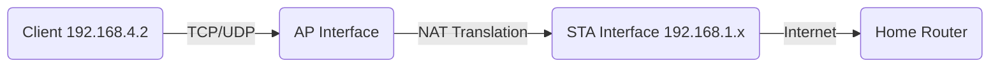
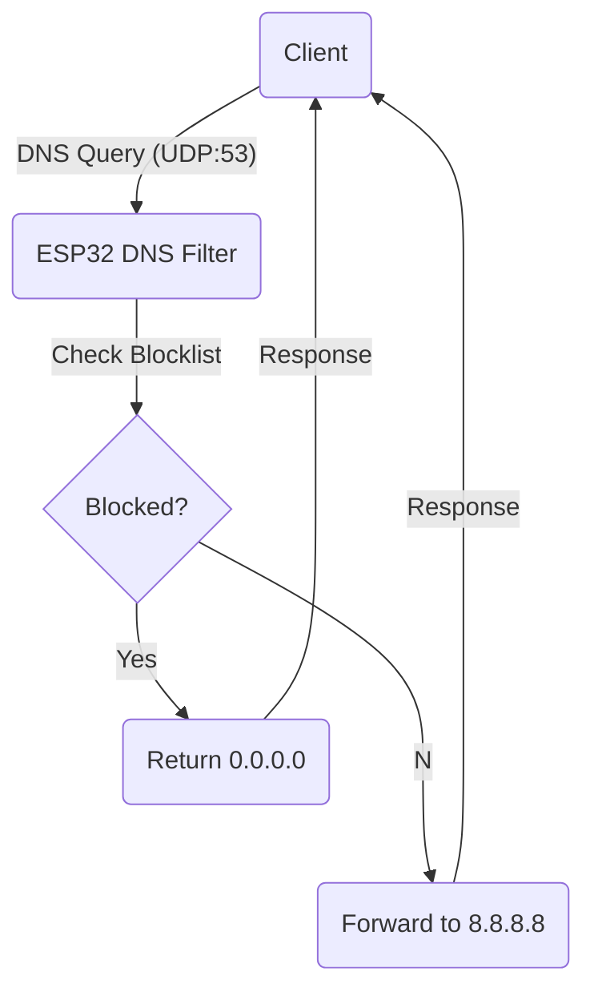

# データ構造と実装詳細

このドキュメントでは、XIAO ESP32-C6 マイクロルーターの内部データ構造、メモリレイアウト、および実装の詳細について説明します。

## 1. メモリレイアウト

ESP32-C6 は 512KB の SRAM を持っています。アプリケーションの使用量は、ネットワークバッファと DNS ブロックリストのために十分なヒープを残すように最適化されています。

| Segment           | Usage                                 | Approx. Size       |
| :---------------- | :------------------------------------ | :----------------- |
| **Flash (Code)**  | Firmware binary                       | ~1 MB              |
| **LittleFS**      | `/blocklist.txt`, web assets (if any) | ~100 KB+           |
| **NVS**           | Configuration (SSID, Passwords)       | ~4 KB              |
| **SRAM (Static)** | Global variables, stack               | ~50 KB             |
| **SRAM (Heap)**   | Dynamic allocation, Network buffers   | ~250 KB            |
| **DNS Buffer**    | `blocklistBuffer` (Malloc)            | **128 KB** (Fixed) |

## 2. 主要なデータ構造

### 2.1 設定 (`Types.h`)

`ConfigManager` と他のモジュール間で設定を受け渡すために使用されます。

```cpp
struct WifiConfig {
  char sta_ssid[33];      // Upstream SSID + null terminator
  char sta_password[65];  // Upstream Password + null terminator
  char ap_password[65];   // AP Password + null terminator
  bool configured;        // Is STA configured?
  bool ap_password_set;   // Is custom AP password set?
};
```

### 2.2 DNS フィルタリング (`DNSFilterManager.h`)

メモリ効率のために最適化されています。`String` オブジェクトの配列ではなく、単一の巨大な文字バッファを使用します。

```cpp
// Statistics counters
struct DNSStats {
  uint32_t totalQueries;     // Total DNS packets received
  uint32_t blockedQueries;   // Matches found in blocklist
  uint32_t allowedQueries;   // Forwarded to upstream
  uint32_t errorQueries;     // Malformed or errors
};

class DNSFilterManager {
private:
    // Memory Optimization:
    // A single large buffer stores all domain strings consecutively.
    // e.g., "google.com\0ads.com\0..."
    char* blocklistBuffer;
    size_t blocklistBufferSize;  // 128 KB
    size_t blocklistBufferUsed;

    // Pointers to the start of each domain in the buffer
    std::vector<const char*> blocklist;

    DNSStats stats;
    // ...
};
```

### 2.3 Web サーバハンドラ

`WebUIManager.cpp` でマッピングされています。

```cpp
// Endpoint mapping strategy
server.on("/", handleRoot);
server.on("/save", HTTP_POST, handleSave);
server.on("/dns-filter", handleDNSFilter);
// ...
```

## 3. ネットワークスタック (lwIP) 設定

ESP32 Arduino Core は lwIP を使用しています。ルーター機能に関する主要な設定：

| Parameter         | Value  | Description                                    |
| :---------------- | :----- | :--------------------------------------------- |
| `IP_NAPT`         | `1`    | Enabled in ESP-IDF config (vital for routing). |
| `IP_FORWARD`      | `1`    | IP Forwarding enabled.                         |
| `TCP_MSS`         | `1460` | Max Segment Size.                              |
| `DNS_MAX_SERVERS` | `3`    | Max upstream DNS servers.                      |

## 4. ファイルシステム (LittleFS)

NVS の容量を超える大きなブロックリストを保存するために使用されます。

| File Path            | Description      | Format                  |
| :------------------- | :--------------- | :---------------------- |
| `/blocklist.txt`     | Active blocklist | Line-separated domains  |
| `/blocklist.txt.tmp` | Upload staging   | Temporary during upload |
| `/blocklist.txt.bak` | Backup           | Previous version        |

**フォーマット例 (`/blocklist.txt`):**

```text
# Adblock list
ads.google.com
doubleclick.net
analytics.yahoo.com
```

## 5. パケットフロー

### 5.1 通常ルーティング (NAT)



### 5.2 DNS フィルタリング


